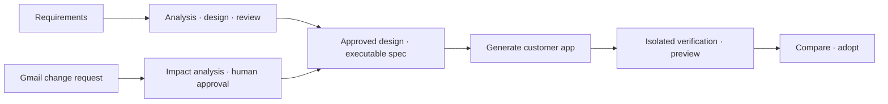

# Specton v2.0.0

[](README.md) [](README.en.md)

**A specification-driven development (SDD) service that analyzes customer requirements and turns approved designs into executable applications.**

Specton analyzes requirement tables in Excel, CSV, HWP, and HWPX to produce **function specifications, ERDs, DDL, and RTMs**. Approved executable contracts generate a domain-specific database, APIs, and basic UI. Gmail requests pass through impact analysis and human approval before a new candidate is generated and re-verified.

[Getting started](docs/en/getting-started.md) · [End-to-end workflow](docs/en/workflow.md) · [Developer docs](docs/en/README.md) · [Supported scope](docs/en/roadmap.md)

## Demo videos

[Watch the demos in your browser](https://surplus96.github.io/specton-demo.html)

Four videos cover requirement analysis, customer application generation, and Gmail change handling. Total running time is approximately **8 min 10 sec**.

| Video | Stage | Duration |
|---|---|---|
| [part_01](docs/en/demo.md#part_01) | Initial design generation | 02:17 |
| [part_02](docs/en/demo.md#part_02) | AI Workspace | 00:33 |
| [part_03](docs/en/demo.md#part_03) | Approved design verification and customer app generation | 02:47 |
| [part_04](docs/en/demo.md#part_04) | Customer change requests through Gmail | 02:33 |

[한국어 시연 가이드](docs/ko/demo.md) · [English demo guide](docs/en/demo.md)

<details>
<summary>Descriptions and playback links — part_01 → part_04</summary>

### part_01

**Initial design generation · 02:17**

Upload a requirements document, review the analysis and design, approve the result, and generate the function specification, ERD, DDL, and RTM.

[Watch part_01](https://surplus96.github.io/specton-demo.html#part_01)

### part_02

**AI Workspace · 00:33**

Inspect analysis and design stages, table relationships, and requirement links in AI Workspace.

[Watch part_02](https://surplus96.github.io/specton-demo.html#part_02)

### part_03

**Approved design verification and customer app generation · 02:47**

Review the executable specification against the approved design, generate and verify source, and inspect the resulting customer application screens and behavior.

[Watch part_03](https://surplus96.github.io/specton-demo.html#part_03)

### part_04

**Customer change requests through Gmail · 02:33**

Collect customer requests through Gmail, analyze their impact, review and approve changes, then inspect the updated result.

[Watch part_04](https://surplus96.github.io/specton-demo.html#part_04)

</details>

## Implemented capabilities

| Area | Capabilities |
|---|---|
| Analysis/design | A01–A09 agents, rule checks, source traceability, human review and final approval |
| Domain packs | Common/inventory/maintenance terminology and patterns with version/provenance checks |
| SDD | Approved-design specs, roles/screens/storage/API bindings, basic customer-app generation |
| Business contracts | Records, transitions, invariants, atomic multi-record commands, calculations/aggregates |
| Verification/adoption | Isolated DB/HTTP/API acceptance/Chromium, previews, candidate comparison and adoption |
| Customer changes | Read-only Gmail ingestion, quotations, AI impact analysis, approved regeneration and retests |
| Design consistency/transfer | Preserved approval baseline, four regenerated artifacts, spec/source consistency, isolated same-schema transfer and failure-recovery checks |
| Delivery | Customer source ZIP, separate login/API roles, installation, file integrity, and backup/recovery tools |



## Domain-specific system generation

Approved tables, keys, and relationships determine storage, APIs, and basic screens. The generator does not insert order, return, or equipment features as defaults. Common, inventory, and maintenance packs provide vocabulary and design policies; a shared compiler implements the execution contracts.

Structural derivation creates insert/list/update drafts. State transitions, multi-record changes, calculations, and aggregates execute after review of explicit business contracts and acceptance expectations. The generated customer UI provides forms, lists, editing, relationship selectors, commands, calculation results, and login. Finished visual-design generation is outside the supported scope.

[Business execution contracts](docs/en/business-contracts.md) · [Specification and approval](docs/en/sdd.md) · [Customer changes](docs/en/gmail-feedback.md)

## Generated outputs

| Stage | Outputs |
|---|---|
| Design approval | Function specification, ERD, DDL, RTM, approved model and hashes |
| Specification approval | Requirement scope, role/screen/API/storage bindings, business rules, executable acceptance cases |
| Source generation | Customer backend/frontend, original/regenerated designs, installation/account/operations tools |
| Verification/adoption | Source-bound reports, per-requirement execution results, comparison/adoption history |
| Customer change | Quoted request, impact analysis/review, new specification/design/source/verification results |

## Quick start

Install Python 3.12/3.13, uv, Node.js 22, and Docker.

```bash
git clone https://github.com/surplus96/specton-v2.0.0.git
cd specton-v2.0.0
cp .env.example .env
uv sync --locked
npm --prefix frontend ci
docker compose up -d --wait db
uv run python -m specton.persistence.migrate upgrade
uv run uvicorn specton.api.main:app --host 127.0.0.1 --port 8000 --reload
```

In another terminal, run `npm --prefix frontend run dev` and open `http://localhost:5173`. Configure the OpenAI key and Google OAuth in `.env` first. Generated-app verification and Gmail analysis require separate workers. See [setup](docs/en/getting-started.md) for the full workflow and [Gmail](docs/en/gmail-feedback.md) for both OAuth callbacks.

Small synthetic [inventory](examples/requirements/inventory.csv) and [maintenance](examples/requirements/maintenance.csv) inputs let you start without customer documents.

## Stack

| Area | Technology |
|---|---|
| Backend | Python, FastAPI, Pydantic, LangGraph, OpenAI API |
| Data | PostgreSQL 18, Alembic, psycopg |
| Frontend | React 19, TypeScript, Vite, React Flow, Mermaid |
| Generation/verification | Declarative contract compilation, Docker, Chromium, pglast |
| Quality | pytest, Ruff, mypy, Vitest, ESLint, GitHub Actions |

## Repository layout

```text
specton/       APIs, agents, contracts, generators, workers, persistence
frontend/      Platform web UI
domain_packs/  Common/inventory/maintenance knowledge and public sources
examples/      Small redistributable synthetic inputs
tests/         Fixed fixtures, unit/integration/browser checks
scripts/       Local services, documentation checks, offline spec review
docker/        Database, generated runtime, browser and web images
docs/ko/       Korean developer documentation
docs/en/       English developer documentation
docs/api/      OpenAPI contract
```

## Testing and execution scope

[Testing](docs/en/testing.md) separates checks without external calls, database/Docker integration, and real model evaluation. Failed, unexecuted, and deferred requirements are not reported as passed.

The project generates **initial systems within approved supported contracts**. Arbitrary business automation, scheduled/external actions, row ownership, general schema-changing migration, automatic production deployment, and finished visual design require additional contracts and implementation. Adoption is not production deployment or complete business acceptance. See [supported behavior and constraints](docs/en/roadmap.md).

## License

[MIT](LICENSE). Original copyright notices, public-data attribution, and [Pretendard OFL](frontend/public/fonts/OFL.txt) are retained. [Pack sources](docs/en/domain-pack-sources.md) describe provenance.
