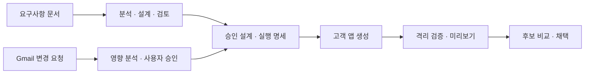

# Specton v2.0.0

[](README.md) [](README.en.md)

**고객 요구사항을 분석하고 승인 설계를 실행 가능한 애플리케이션으로 연결하는 명세 기반 개발(SDD) 서비스입니다.**

Excel·CSV·HWP·HWPX의 요구사항 표를 분석해 **기능 명세서·ERD·DDL·RTM**을 만들고, 사용자 승인을 거친 실행 명세로 해당 도메인의 DB·API·기본 UI를 생성합니다. Gmail API로 받은 수정 요청은 영향 분석과 검토·승인 후 새 후보로 구현하고 재검증합니다.

[설치와 실행](docs/ko/getting-started.md) · [전체 처리 흐름](docs/ko/workflow.md) · [개발 문서](docs/ko/README.md) · [지원 범위](docs/ko/roadmap.md)

## 시연 영상

요구사항 분석부터 고객 앱 생성과 Gmail 변경 반영까지 네 편으로 확인할 수 있습니다. 총 재생 시간은 약 **8분 10초**입니다.

| 영상 | 내용 | 재생 시간 |
|---|---|---|
| [part_01](docs/ko/demo.md#part_01) | 초기 설계도 생성 | 02:17 |
| [part_02](docs/ko/demo.md#part_02) | AI Workspace | 00:33 |
| [part_03](docs/ko/demo.md#part_03) | 승인 설계 검증과 고객 앱 생성 | 02:47 |
| [part_04](docs/ko/demo.md#part_04) | Gmail 고객 변경 요청 반영 | 02:33 |

[한국어 시연 가이드](docs/ko/demo.md) · [English demo guide](docs/en/demo.md)

<details>
<summary>영상 펼쳐 보기 — part_01 → part_04</summary>

### part_01

**초기 설계도 생성 · 02:17**

요구사항 문서를 등록하고 분석·검토·승인을 거쳐 기능 명세서·ERD·DDL·RTM을 생성하는 흐름입니다.

https://github.com/user-attachments/assets/a1f762ea-d0cb-4ba6-859c-3d469e324044

### part_02

**AI Workspace · 00:33**

분석·설계 단계별 결과, 테이블 관계와 요구사항의 연결을 AI Workspace에서 확인합니다.

https://github.com/user-attachments/assets/07aaf18c-73c0-4353-98bc-02764b9bd99e

### part_03

**승인 설계 검증과 고객 앱 생성 · 02:47**

승인 설계를 기준으로 실행 명세를 검토하고 소스를 생성·검증한 뒤, 실제 고객이 사용할 앱의 화면과 동작을 확인합니다.

https://github.com/user-attachments/assets/82a5424c-db7e-4776-9238-20fead78588f

### part_04

**Gmail 고객 변경 요청 반영 · 02:33**

Gmail로 받은 수정 요청을 수집하고 영향 분석·검토·승인을 거쳐 변경을 반영한 뒤 결과를 확인합니다.

https://github.com/user-attachments/assets/a2f50cdf-c712-4be7-87f6-919c8fbe890a

</details>

## 현재 구현 기능

| 영역 | 제공 기능 |
|---|---|
| 요구 분석·설계 | A01~A09 에이전트, 규칙 검사, 원문 추적, 사용자 확인·최종 승인 |
| 도메인 팩 | 공통 표준·재고·설비의 용어/패턴과 버전·출처 검증 |
| SDD | 승인 설계 기반 실행 명세, 역할·화면·저장·API 연결, 기본 고객 앱 생성 |
| 업무 계약 | 레코드 작업·상태 전이·불변 조건·원자적 다중 레코드 명령·계산/집계 |
| 검증·채택 | 격리 DB/HTTP·API 인수·Chromium 검사, 미리보기, 후보 비교·채택 |
| 고객 변경 | Gmail 읽기 수집, 원문 인용, AI 영향 분석, 승인 변경·설계 재생성·재검증 |
| 설계 일치·이전 | 원본 승인 보존, 네 문서 재생성, 소스·명세 일치, 동일 구조의 격리 데이터 이전·실패 복구 검사 |
| 납품 | 고객 앱 소스 ZIP, 별도 로그인·API 역할, 설치·파일 무결성·백업/복구 도구 |



## 도메인에 따른 시스템 생성

승인 설계의 테이블·키·관계를 읽어 해당 도메인의 저장 구조, API, 기본 화면을 구성합니다. 주문·반품·설비 기능이 기본값으로 삽입되는 방식이 아닙니다. 현재 공통·재고·설비 팩을 제공하며, 팩은 용어·설계 정책을 관리하고 생성기는 공통 실행 계약을 컴파일합니다.

구조 도출은 등록·조회·수정 초안을 만듭니다. 상태 전이·다중 레코드 변경·계산·집계는 명시된 업무 계약과 인수 기대값을 검토한 뒤 실행합니다. 생성 고객 UI는 폼·목록·수정·관계 선택·명령·계산 결과·로그인을 제공하며, 완성형 시각 디자인 생성은 지원 범위에 포함되지 않습니다.

[업무 실행 계약](docs/ko/business-contracts.md) · [명세 작성과 승인](docs/ko/sdd.md) · [고객 변경 처리](docs/ko/gmail-feedback.md)

## 생성 산출물

| 단계 | 산출물 |
|---|---|
| 설계 승인 | 기능 명세서, ERD, DDL, RTM, 승인 모델과 해시 |
| 명세 승인 | 요구별 범위, 역할·화면·API·저장 매핑, 업무 규칙, 실행 인수 사례 |
| 소스 생성 | 고객 앱 백엔드·프런트엔드, 원본·재생성 설계, 설치·계정·운영 도구 |
| 검증·채택 | 소스에 연결된 검사 보고서, 요구별 실행 결과, 비교·채택 이력 |
| 고객 변경 | 메일 원문 인용, 영향 분석·검토 기록, 새 명세·설계·소스·검증 결과 |

## 빠른 시작

Python 3.12/3.13, uv, Node.js 22, Docker를 준비합니다.

```bash
git clone https://github.com/surplus96/specton-v2.0.0.git
cd specton-v2.0.0
cp .env.example .env
uv sync --locked
npm --prefix frontend ci
docker compose up -d --wait db
uv run python -m specton.persistence.migrate upgrade
uv run uvicorn specton.api.main:app --host 127.0.0.1 --port 8000 --reload
```

다른 터미널에서 `npm --prefix frontend run dev`를 실행하고 `http://localhost:5173`을 엽니다. `.env`의 OpenAI 키와 Google OAuth를 먼저 설정하세요. 앱 생성 검증·Gmail 분석에는 별도 작업자가 필요합니다. 전체 설정과 실행 명령은 [설치 안내](docs/ko/getting-started.md), 두 OAuth 콜백은 [Gmail 안내](docs/ko/gmail-feedback.md)에 있습니다.

고객 자료 없이 시작할 수 있는 [재고](examples/requirements/inventory.csv)·[설비](examples/requirements/maintenance.csv) 합성 입력을 제공합니다.

## 기술 구성

| 영역 | 기술 |
|---|---|
| 백엔드 | Python, FastAPI, Pydantic, LangGraph, OpenAI API |
| 데이터 | PostgreSQL 18, Alembic, psycopg |
| 프런트엔드 | React 19, TypeScript, Vite, React Flow, Mermaid |
| 생성·검증 | 선언형 계약 컴파일, Docker, Chromium, pglast |
| 품질 | pytest, Ruff, mypy, Vitest, ESLint, GitHub Actions |

## 저장소 구조

```text
specton/       API·에이전트·계약·생성기·작업자·저장 계층
frontend/      플랫폼 웹 UI
domain_packs/  공통·재고·설비 지식과 공개 출처
examples/      공개 가능한 작은 합성 입력
tests/         고정 fixture와 단위·통합·브라우저 검사
scripts/       로컬 실행·문서 검사·오프라인 명세 검토
docker/        DB·생성 앱·브라우저·웹 이미지 구성
docs/ko/       한국어 개발 문서
docs/en/       English developer documentation
docs/api/      OpenAPI 계약
```

## 테스트와 실행 범위

[테스트 안내](docs/ko/testing.md)에 외부 호출 없는 검사, DB/Docker 검사, 실제 LLM 평가를 구분했습니다. 미실행·실패·유예 요구를 통과로 처리하지 않습니다.

이 프로젝트는 **승인된 지원 계약 범위의 초기 시스템 생성**을 다룹니다. 모든 고객 업무의 자동 구현, 일정 실행·외부 동작, 행별 소유권, 임의 구조 변경 데이터 이전, 운영 자동 배포, 완성형 시각 디자인은 추가 계약과 구현이 필요합니다. 후보 채택은 운영 배포나 전체 업무 인수 완료를 뜻하지 않습니다. [구현 범위와 제약](docs/ko/roadmap.md)을 확인하세요.

## 라이선스

[MIT](LICENSE). 원저작권 고지, 공개 데이터 출처, [Pretendard OFL](frontend/public/fonts/OFL.txt)을 유지합니다. 자료별 근거는 [팩 출처](docs/ko/domain-pack-sources.md)에 정리했습니다.
