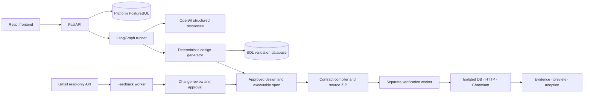

# Architecture and data flow

 

## Components

The platform database, design SQL sandbox, and generated application's test/customer database have separate responsibilities. Generated applications do not reuse platform tables or Google login sessions.

## Module boundaries

| Path | Responsibility |
|---|---|
| `specton/ingest/` | Table extraction, source locations, input limits |
| `specton/nodes/`, `agent_nodes.py` | Structured analysis, design, and review calls |
| `specton/graph.py`, `runner.py` | Stages, questions, resume, leases, rework |
| `specton/contracts/` | Design, specification, command, calculation, acceptance contracts |
| `specton/codegen/` | IDs, naming, FK/N:M normalization, four design artifacts |
| `specton/review/`, `validate/` | Rules, evidence checks, allowed SQL and isolated execution |
| `specton/specification/` | Approved baseline, executable specs, readiness and acceptance review |
| `specton/implementation/` | Compilation, packaging, verification, transfer rehearsal |
| `specton/feedback/`, `integrations/` | Gmail consent, ingestion, change analysis and jobs |
| `specton/persistence/` | Platform tables, Alembic, snapshots, approvals and job records |
| `frontend/` | User interface and API clients |

## Agents and deterministic processing

A01 analyzes FR/NFR requirements, splits compound statements, and raises questions. A02 proposes functions, A03 entities/attributes/CRUD, and A04 relationships. The server validates stable IDs and references, normalizes the model, and generates function specifications, ERDs, DDL, and RTMs.

A05–A08 review relationship contradictions, missing data, nonfunctional requirements, and normalization. `combined` groups perspectives into one call; `parallel` separates them. Merging rule and model findings validates target IDs, quotations, and duplicate fingerprints. Deterministic routing selects known rework stages; A09 handles unmapped findings. Repeated findings and rework limits return control to the user.

The LLM does not execute arbitrary SQL, code, or foreign keys. Documents and email are input data, not instructions that expand agent permissions. Failed and unexecuted reviews remain explicit.

## Approval, reproducibility, and recovery

- Designs are tied to run IDs/revisions and normalized model, pack, policy, and prompt hashes.
- A project owner connects an approved design as its baseline. Downloading design documents is separate from validating an executable application.
- Executable specs have their own `spec_id`, `spec_version`, content hash, and approval status. An AI proposal is not approval.
- Source archives and reports are tied to spec/source hashes, verification code, and image IDs.
- Candidate adoption checks the current baseline, comparison hash, and verification evidence, with optimistic concurrency and an audit history.
- Expired execution/job leases can be reclaimed. Recovery retains checkpoints, approvals, and artifacts rather than treating a restarted run as successful.

## Versions and persisted objects

| Object | Identity/version | Responsibility |
|---|---|---|
| Document run/design | Run ID, revision, model/artifact hashes | Source analysis through final design approval |
| Project baseline | Project ID, approved design baseline | Ownership and reference design |
| Executable specification | `spec_id`, `spec_version`, spec hash | Role/screen/API/storage/business/acceptance contracts |
| Implementation candidate | Implementation ID, source hash, template version | Deterministic source package for an approved spec |
| Verification/preview | Job ID, image/suite hashes, lease | Source-specific isolated execution and access |
| Customer change/adoption | Change ID, proposal/comparison hashes, adoption history | Approved changes and baseline updates |

`spec-v0.9` / `domain-ir-v3` are contract formats including calculations/aggregates; `executable-design-v11` is the generated-source template version. They are independent of API versions, DB migrations, and the repository version name. See [business contracts](business-contracts.md) and the [workflow](workflow.md).

## Data contracts

`SourceRef` preserves sheet/row or section/paragraph/table/cell locations. Customer `source_id` values are distinct from internal IDs. Functions, entities, and relationships reference real requirements through `req_ids`; missing trace links are not invented.

Persistent contracts are defined by [migrations](../../specton/persistence/) and the [API contract](api.md). Generated application contracts are described in [SDD](sdd.md). The Pydantic models in [contracts](../../specton/contracts/) are authoritative; documentation does not maintain competing copies of large JSON schemas.

---

[Documentation](README.md) · [Project](../../README.en.md)
