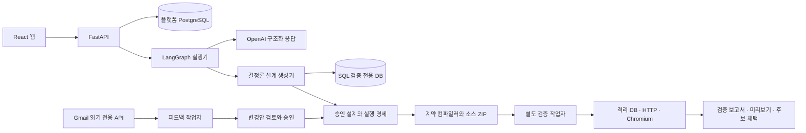

# 아키텍처와 데이터 흐름

 

## 구성

플랫폼 DB, 설계 DDL 검증 DB, 생성 앱의 검증/고객 DB는 서로 다른 책임을 가진다. 생성 앱은 플랫폼 내부 테이블이나 Google 로그인 세션을 재사용하지 않는다.

## 모듈 경계

| 경로 | 책임 |
|---|---|
| `specton/ingest/` | 표 추출, 문서 원문 위치, 입력 제한 |
| `specton/nodes/`, `agent_nodes.py` | 분석·설계·관점 검토의 구조화 LLM 호출 |
| `specton/graph.py`, `runner.py` | 실행 단계, 확인 질문, 재개, lease, 재작업 |
| `specton/contracts/` | 설계·명세·명령·계산·인수 계약 |
| `specton/codegen/` | ID·명명·FK·N:M 정리, 네 설계 산출물 |
| `specton/review/`, `validate/` | 규칙·근거 검토, SQL 허용 문법과 격리 실행 |
| `specton/specification/` | 승인 기준 연결, 실행 명세, 준비도·인수 검토 |
| `specton/implementation/` | 계약 컴파일, 패키지, 자동 검증, 이전 검증 |
| `specton/feedback/`, `integrations/` | Gmail 동의·수집, 변경 분석·작업 큐 |
| `specton/persistence/` | 플랫폼 테이블, Alembic, 스냅샷·승인·작업 기록 |
| `frontend/` | 사용자 화면과 API 클라이언트 |

## A01~A09와 결정론 처리

A01은 원문을 FR/NFR로 분석하고 복합 요구와 확인 질문을 정리한다. A02는 기능, A03은 엔티티·속성·CRUD, A04는 관계를 제안한다. 서버가 안정 ID와 참조를 검증하고 모델을 정리한 뒤 기능 명세·ERD·DDL·RTM을 생성한다.

A05~A08은 관계 모순·데이터 누락·비기능 요구·정규화를 검토한다. `combined`는 관점을 한 호출에 묶고 `parallel`은 나눠 실행한다. 규칙 검사와 LLM 지적을 합칠 때 실제 대상 ID·원문 인용·중복 지문을 확인한다. 라우팅 규칙으로 대상 단계가 확정되면 바로 이동하고, 미매핑 지적에 A09를 사용한다. 반복 지적과 재작업 한도에서는 사용자 판단을 요청한다.

LLM이 임의 SQL·코드·FK를 실행하는 구조가 아니다. 원문과 메일은 분석 데이터이며 에이전트의 권한을 바꾸는 지시로 해석하지 않는다. 리뷰 실패와 미실행을 정상 결과로 바꾸지 않는다.

## 승인·재현·복구

- 설계는 실행 ID와 revision, 정리 모델·팩·정책·프롬프트 해시에 연결된다.
- 프로젝트 소유자가 승인한 설계를 프로젝트의 기준으로 연결한다. 원본 문서 다운로드와 실행 앱 검증은 별도 단계다.
- 실행 명세는 독립된 `spec_id`, `spec_version`, 내용 해시와 승인 상태를 갖는다. AI 제안만으로 승인되지는 않는다.
- 소스 ZIP·검증 보고서는 해당 명세와 소스 해시, 검사 코드와 이미지 ID에 묶인다.
- 후보 채택은 현재 기준·비교 해시·검증 근거를 확인하는 낙관적 경합 검사와 이력을 사용한다.
- 실행·작업 큐의 lease 만료는 재획득 대상이다. 기존 체크포인트·승인·산출물을 덮어쓰며 처음부터 성공 처리하지 않는다.

## 버전과 저장 객체

| 객체 | 식별·버전 | 책임 |
|---|---|---|
| 문서 실행·설계 | 실행 ID, revision, 모델·산출물 해시 | 원문 분석부터 최종 설계 승인 |
| 프로젝트 기준 | 프로젝트 ID, 승인 설계 기준 | 소유권과 기준 설계 연결 |
| 실행 명세 | `spec_id`, `spec_version`, 명세 해시 | 역할·화면·API·저장·업무·인수 계약 |
| 구현 후보 | 구현 ID, 소스 해시, 템플릿 버전 | 승인 명세의 결정론 소스 묶음 |
| 검증·미리보기 | 작업 ID, 이미지·검사 해시, lease | 해당 소스의 격리 실행과 접근 |
| 고객 변경·채택 | 변경 ID, 제안·비교 해시, 채택 이력 | 승인 변경과 프로젝트 기준 갱신 |

`spec-v0.9` / `domain-ir-v3`는 계산·집계를 포함한 계약 형식이며 `executable-design-v11`은 생성 소스 템플릿 버전이다. API 버전, DB 마이그레이션, 저장소 버전 이름과 별도로 관리한다. [업무 계약](business-contracts.md)과 [전체 흐름](workflow.md)을 함께 참조한다.

## 데이터 계약

`SourceRef`는 원문 시트·행 또는 구역·문단·표·셀을 보존한다. 고객의 `source_id`와 서버 내부 ID를 구별한다. 기능·엔티티·관계의 `req_ids`는 실제 요구를 참조하며 빈 추적 연결을 임의로 보충하지 않는다.

플랫폼의 영속 계약은 [마이그레이션](../../specton/persistence/)과 [API 계약](api.md), 앱 실행 계약은 [SDD](sdd.md)가 기준이다. 자세한 타입은 [contracts](../../specton/contracts/)의 Pydantic 모델을 따른다. 대형 JSON 사본을 문서에 복제해 코드와 다른 계약을 만들지 않는다.

---

[문서 목록](README.md) · [프로젝트](../../README.md)
