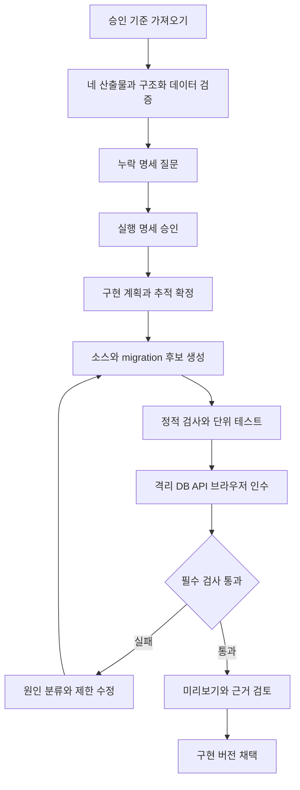

# SDD 기반 초기 업무 시스템 구현 설계

## 구현 목표

SDD는 Spec Driven Development로 정의한다. 승인된 기능 명세서·ERD·DDL·RTM을 기반으로 **초기 시스템 폴더 구조, 업무 API, 영속 DB, 실제 동작하는 화면, 요구사항별 테스트**를 생성하고 검증 가능한 소스 묶음과 미리보기를 제공한다.

초기 템플릿은 FastAPI·Pydantic·psycopg·PostgreSQL, React·TypeScript·Vite 한 종류다. 기본 생성은 결정론 템플릿과 제한된 업무 규칙 모델을 사용한다. LLM은 누락 명세·구현 계획·지원되는 로직 패치 후보를 제안하지만 승인 여부·테스트 결과·파일 경계는 코드가 판단한다.

## 산출물과 실행 명세 연결

| 입력 | 사용 방식 | 중단 조건 |
|---|---|---|
| 기능 명세 | 명령·조회·행위자·처리 조건 후보 | 수용 기준·권한·오류 조건이 미정 |
| ERD·정리 모델 | 엔티티·속성·키·관계 기준 | DDL과 객체·참조가 다름 |
| DDL | 초기 스키마 기준, 검증된 타입·제약 | 미승인·해시 불일치·검증 실패 |
| RTM | 원문·요구사항·기능·데이터 추적 | 선택한 Must 요구가 미연결 |
| 스냅샷·승인 근거 | 파일과 구조화 데이터의 동일 버전 확인 | run/revision/model_hash/파일 해시 불일치 |

새 `SpecBundle`에 인증 역할, 유스케이스, API, 화면, 상태 전이, 업무 불변식, 트랜잭션 경계, 테스트 사례, 미해결 질문을 추가한다. 이를 기존 네 산출물을 대체하는 별도 근거로 쓰지 않고 동일 기준의 실행 계약으로 연결한다. 사용자가 추가한 업무 규칙은 새 요구사항으로 등록해 원래 문서에 있었다고 표시하지 않는다.

## 실행 계약

| 구성 | 필수 필드 |
|---|---|
| 기준 | project_id, baseline_id, source_run_id, source_revision, manifest_hash, artifact_hashes |
| 식별 | schema_version, spec_version, spec_hash, stable_object_ids, legacy_id_map |
| 유스케이스 | id, req_ids, actor_roles, preconditions, inputs, steps, outputs, errors, transaction |
| 불변식 | id, entity/field 참조, 허용 연산 AST, 적용 계층, req_ids |
| 상태 전이 | from, command, to, guard, permission, side_effect, idempotency |
| API | method, path, request/response schema, 오류 코드, pagination, concurrency |
| 화면 | route, role, layout, fields, actions, API binding, 빈/오류/로딩 상태 |
| 테스트 | stable TC id, req_ids, Given/When/Then, fixtures, expected state, tier |
| 미정 | 질문, 근거, 영향, 해결 상태, 승인자·시각 |

`eval` 가능한 자유 문자열을 규칙으로 실행하지 않는다. 비교·집합·논리·필드 참조 등 허용 연산만 AST로 표현하고 컴파일한다. 초기 범위 밖 규칙은 `unsupported`로 남기고 사용자 결정 또는 수동 확장 지점으로 넘긴다. CRUD가 있다고 업무 규칙을 구현 완료로 표시하지 않는다.

## 첫 업무 수직 구현

다음은 제품 설계 제안이며 고객 원문의 확정 조건은 아니다. 초기 데모 입력과 사용자가 승인한 실행 명세로 확정한다.

| 흐름 | 동작과 검증 |
|---|---|
| 기준정보 | 창고·품목 코드 중복 거절, 목록·상세·등록·수정 |
| 입고 초안 | 1개 이상 항목, 수량 양수·소수 셋째 자리, 초안만 편집 |
| 입고 확정 | 초안→확정, 원장과 잔량을 한 트랜잭션으로 반영 |
| 출고 확정 | 재고 충분할 때만 차감, 동시 요청에도 음수 금지 |
| 확정 취소 | 삭제 대신 반대 원장, 중복 취소 거절, 부족 재고 시 취소 제한 질문 |
| 재고 조회 | 창고·품목 조건과 페이징, 변경 후 API·화면 일치 |
| 권한 | 조회자·업무 처리자·관리자, UI 숨김과 서버 권한 검사를 함께 적용 |

입출고 확정은 명령 ID 또는 `Idempotency-Key`로 중복 적용을 막는다. `(warehouse_id, item_id)` 잔량 행 잠금 또는 조건부 원자 UPDATE와 UNIQUE 키를 사용하고 동시 생성 충돌도 처리한다. 원장과 잔량 중 하나만 저장되면 전체 롤백한다. 소수는 DB numeric과 서버 Decimal로 보존한다.

## 처리 파이프라인



기존 설계 그래프는 문서 산출까지 유지한다. 새 구현 그래프는 `specton/implementation/`에 둔다. 연결 어댑터는 승인 스냅샷을 읽어 `SpecBundle` 후보를 만들며 기존 `RunState`에 구현 단계를 혼합하지 않는다.

| 구성 요소 | 역할 | 권한 |
|---|---|---|
| 명세 보완 노드 | 근거와 미정 질문 정리 | 읽기, 질문 제안 |
| 구현 계획 노드 | 파일·API·화면·테스트 대응 계획 | 계획 후보만 작성 |
| 결정론 생성기 | 템플릿·AST 기반 코드·DDL 생성 | 작업 디렉터리만 쓰기 |
| 구현 보완 노드 | 허용 custom 영역의 patch 제안 | diff 후보, 명령 실행 불가 |
| 검증 작업자 | build·테스트·미리보기 실행 | 지정 작업 환경·명령만 |
| 결과 검토 | 실패 원인·누락·위험 요약 | 증거 읽기, 결과 조작 불가 |

새 노드 수·이름은 위 책임을 기준으로 구현 시 확정한다. 기존 A01~A09 번호의 의미를 바꾸지 않는다.

## 소스 구조와 재생성

```text
workspace/
  spec/approved-spec.json
  backend/app/generated/      API DTO와 기본 CRUD
  backend/app/domain/         승인된 업무 규칙과 서비스
  backend/app/custom/         명시적 수동 확장 지점
  backend/migrations/         버전별 스키마 이전
  frontend/src/generated/     경로 폼 테이블 API client
  frontend/src/custom/        수동 화면 확장 지점
  tests/acceptance/            승인한 요구별 인수 테스트
  traceability.json
  build-manifest.json
  compose.preview.yml
```

출력 경로는 allowlist로 제한하고 상대경로 이탈·symlink·기존 `.git`·CI·비밀 파일 쓰기를 막는다. 생성 대상의 파일 해시를 manifest에 기록한다. 변경 시 마지막 생성본·현재 소스·새 생성본을 3-way 비교하고 custom 코드는 보존한다. 충돌이 있으면 사용자 검토로 멈춘다. 생성 코드 주석만으로 수동 코드 소유 경계를 추측하지 않는다.

템플릿·라이브러리·런타임 이미지는 버전과 digest로 고정한다. 동일 명세·템플릿의 순수 생성 결과는 동일해야 한다. LLM이 제안한 patch는 응답 바이트와 적용 diff를 저장하되 재호출이 같은 소스를 만든다고 보장하지 않는다.

## 화면 설계

플랫폼에 다음 화면을 추가한다.

| 화면 | 핵심 정보와 행동 |
|---|---|
| 프로젝트 개요 | 채택한 설계·명세·구현 버전, 최근 변경, 새 구현 시작 |
| 실행 명세 확인 | 왼쪽 원문·기능, 가운데 API/화면/규칙, 오른쪽 질문·수용 기준 |
| 구현 작업 | 단계·대기 이유·로그 요약·취소, 실패 위치 |
| 검증 결과 | 요구별 통과/실패/미실행, API·DB·브라우저 증거와 재실행 |
| 미리보기 | 생성 앱 열기, 사용한 데이터·버전, 만료·정지 상태 |
| 후보 비교 | 이전 대비 명세·코드·스키마·테스트 변화, 채택·기각 |

생성 앱의 인증은 플랫폼 세션과 분리한다. 데모 계정의 비밀번호는 작업별로 생성해 비밀 저장소에 두고 소스·이미지·테스트 로그에 넣지 않는다. 생성 앱에는 로그인, 창고·품목 목록/편집, 입출고 목록/상세/편집/확정, 재고 조회 화면을 제공한다. 화면 명세는 행위·검증 규칙·오류·권한을 API와 연결하며 하드코딩 샘플 데이터를 실제 연동으로 표시하지 않는다.

## 격리 실행과 검증 경계

기존 DDL 검사 DB는 SQL 검사 전용으로 남긴다. 생성 앱에는 작업마다 별도 DB·계정·네트워크를 만든다. 플랫폼 DB·OAuth token·LLM key·호스트 홈·Docker socket을 생성 앱에 전달하지 않는다.

실행 작업자는 별도 호스트 또는 VM 경계에서 동작한다. 개발용 Docker도 non-root, read-only rootfs, 제한된 tmpfs, CPU·메모리·PID·시간·출력 상한, capabilities 제거, seccomp, 외부 네트워크 기본 차단을 적용한다. 의존성 설치는 검토된 lock과 사전 준비 이미지/레지스트리 allowlist를 사용한다. 컨테이너 격리만으로 임의 생성 코드를 안전하다고 간주하지 않는다. [Docker 보안 문서](https://docs.docker.com/engine/security/)

미리보기는 플랫폼과 다른 origin, 짧은 수명 토큰, 프로젝트 소유 확인, 만료 후 정지·삭제를 적용한다. 생성 앱에 플랫폼 세션 쿠키가 전달되지 않게 한다. 초기 기본 자원 제안은 동시 build 1개, 2 vCPU·4GiB, 작업 20분, 로그 20MiB, 미리보기 60분이며 기준선 측정 후 조정한다.

## 테스트와 제한 수정

명세 승인 시 고정한 인수 테스트는 생성 구현이 임의 수정하지 못한다. 코드 생성과 같은 응답에서 나온 테스트만으로 통과를 판단하지 않고 사전 정의 fixture·DB 직접 확인·외부 API 호출·브라우저 조작을 조합한다.

실패를 코드·명세 불충분·환경·불안정 테스트로 나눈다. 코드 문제만 최대 2회 자동 보완하고, 같은 실패 지문이 반복되거나 명세 변경이 필요하면 멈춘다. 테스트 삭제·assert 약화·skip 전환으로 성공을 만들지 않는다. 예산·시간·파일 변경 범위 초과도 명시적 중단이다.

검증 결과는 `spec_hash + source_commit/tree_hash + migration_hash + test_suite_hash + image_digest + fixture_hash`에 묶는다. 검증 후 소스가 바뀌면 채택을 거절한다. 사용자 채택은 배포와 별개이며 소스 묶음과 실행 방법을 함께 제공한다.

## 인수 결과물

네 설계 산출물, 승인 실행 명세, 생성 소스, lock·컨테이너 실행 구성, migration, 추적 매핑, JUnit·브라우저 trace·필요 캡처, 검증 manifest, 미지원·미실행 목록을 하나의 구현 버전에 연결한다. 필수 업무 API와 실제 화면이 동작하고 요구별 테스트가 확인돼야 SDD 첫 구현 완료로 판정한다.
