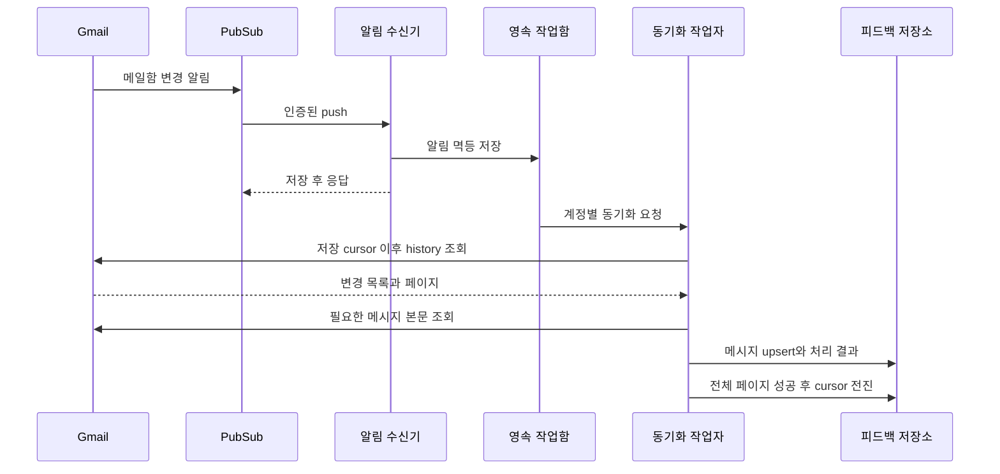

# Gmail API 고객 피드백 수집과 변경 반영 설계

## 범위

사용자가 연결한 Gmail 계정에서 고객의 수정 요청을 읽고 Specton 안에서 요청 원문·요구사항·영향 범위를 확인한다. 승인한 요청을 새로운 명세와 구현 후보로 만들고 SDD 검증 흐름을 다시 실행한다. **Gmail API 직접 연동**을 사용하며 MCP 서버나 ChatGPT의 Gmail 연결을 제품 의존성으로 두지 않는다.

초기 범위는 읽기·동기화·내부 처리 상태다. 메일 발송·삭제·읽음 처리·Gmail 라벨 변경은 포함하지 않는다. 고객 회신이 필요하면 결과 요약을 내려받거나 복사할 수 있게 하고 자동 발송은 별도 범위로 둔다.

## 사용자 흐름

1. 지속적인 Specton 계정으로 로그인하고 Gmail 계정을 OAuth로 연결한다.
2. 수집할 기존 Gmail 라벨·발신자·제목 규칙·시작 시점을 확인하고 초기 수집 범위를 저장한다.
3. 수신함에서 메일과 프로젝트 연결 후보를 확인한다. 자동 매핑이 불명확하면 미분류로 둔다.
4. 원문을 인용한 변경 요청 후보를 생성한다. 한 메일의 여러 요구는 개별 요청으로 분리한다.
5. 기존 요구사항·명세·코드·화면·DB·테스트에 대한 영향과 질문을 검토한다.
6. 요청과 기준 버전을 확정하면 변경 전용 명세·설계·구현 작업을 만든다.
7. 변경 테스트와 기존 회귀 결과, 미리보기·스키마 이전안을 검토해 새 구현 기준을 채택한다.

메일 수신, 변경 요청 승인, 실제 구현 완료, 고객의 결과 수용을 각각 구분한다. 검증 통과만으로 고객 수용 상태를 자동 완료하지 않는다.

## OAuth와 연결 수명

지속 사용자 인증을 먼저 추가한다. Gmail 연결 승인과 Specton 로그인은 다른 권한이며, 로그인만으로 메일 접근을 허용하지 않는다. 연결에는 authorization code 흐름, 서버 측 `state`와 로그인 세션 바인딩, 등록 redirect URI, 필요 시 PKCE, offline access를 사용한다. 토큰 교환은 서버에서 수행하고 refresh token은 암호화 저장소/KMS로 관리한다. 새 응답에 refresh token이 없으면 기존 값을 null로 덮어쓰지 않는다. [Google 웹 서버 OAuth 가이드](https://developers.google.com/identity/protocols/oauth2/web-server)

최소 권한은 본문 확인이 가능한 `gmail.readonly`다. `gmail.metadata`로는 본문을 읽을 수 없다. 읽기 scope도 restricted이므로 외부 고객 대상 공개와 서버 저장·전송 방식에 따라 검증·보안 평가 요건을 출시 조건으로 확인한다. 테스트·내부 사용 예외는 실제 배포 형태로 판단하며 비용·승인 일정을 고정하지 않는다. [Gmail 권한 범위](https://developers.google.com/workspace/gmail/api/auth/scopes), [제한 scope 검증](https://developers.google.com/identity/protocols/oauth2/production-readiness/restricted-scope-verification)

연결 상태는 `pending → active → reauth_required/paused → disconnected`다. `invalid_grant`는 무한 재시도하지 않고 재연결 안내로 전환한다. 연결 해제 시 watch 중지·작업 중단·token 폐기를 처리한다. 기존 수집 데이터 삭제는 보존 정책과 사용자 선택에 따라 별도 처리한다.

메일 라벨·검색 규칙은 앱의 수집 필터이며 OAuth 권한 자체를 특정 메일로 제한하지는 않는다. UI에 실제 권한과 실제 수집 범위를 구분해 표시한다.

## 동기화 구조

### 초기 동기화

초기 범위는 최근 30일·최대 500건을 제안하고 사용자가 선택한다. `messages.list`의 모든 대상 페이지와 필요한 `messages.get`을 수집한다. watch 시작 시점과 초기 수집 사이의 변경을 놓치지 않도록 기준 history를 먼저 확보하고, 초기 수집 후 그 기준부터 catch-up 한다. 전체 완료 전에는 `initial_sync_in_progress`를 표시하고 최종 cursor를 확정하지 않는다.

### 증분 동기화

Gmail push는 메일 본문 대신 mailbox 변경 단서를 전달한다. watch는 최소 7일 이내 갱신이 필요하며, 매일 갱신하고 실제 expiration을 저장한다. 알림 지연·누락에 대비해 주기적으로 history 동기화도 수행한다. [Gmail push 가이드](https://developers.google.com/workspace/gmail/api/guides/push)

`history.list(startHistoryId=last_committed_history_id)`를 페이지 끝까지 읽고 필요한 메시지를 저장한다. 메시지 id와 Pub/Sub message id는 다른 값이다. `historyId`는 JS 부동소수점으로 변환하지 않고 문자열/정밀 정수로 처리한다. 404로 cursor가 만료되면 목적에 맞는 범위의 전체 동기화를 다시 수행하고 누락 가능 기간과 복구 범위를 표시한다. [Gmail 동기화 가이드](https://developers.google.com/workspace/gmail/api/guides/sync)

계정별 lease로 동시에 cursor를 갱신하지 않는다. 알림은 `(subscription, pubsub_message_id)`, 메일은 `(connection_id, gmail_message_id)`로 중복 저장을 막는다. 과거·역순 알림은 cursor를 후퇴시키지 않는다. 한 메일에 여러 변경 요청이 있을 수 있으므로 변경 요청의 중복 키에는 추출 버전과 후보 ID를 추가한다.

Pub/Sub push의 서명·issuer·audience·만료·설정한 서비스 계정 email/email_verified를 검증한다. 메시지의 emailAddress만으로 소유자를 신뢰하지 않고 검증한 subscription과 연결 계정을 조회한다. 영속 저장이 실패하면 성공 응답을 반환하지 않는다. [Pub/Sub push 인증](https://docs.cloud.google.com/pubsub/docs/authenticate-push-subscriptions)

로컬·IP 제한 서버는 수동 동기화와 주기 polling으로 시작할 수 있다. 공개 webhook을 추가할 때 기존 관리 화면의 IP 제한을 해제하지 않고 알림 수신기만 별도 노출하거나 Pub/Sub pull을 선택한다. 최초 단계는 API polling, 운영 확장은 push + reconciliation을 기본안으로 한다.

### 실패와 재처리

429·일시 5xx는 지수 backoff·jitter·Retry-After를 적용한다. 기본 5회 후 지연 작업함으로 옮기고 UI에서 재처리한다. 인증 오류와 본문 파싱 오류를 구분한다. 특정 메시지 실패를 버리고 cursor를 전진시키지 않으며, 영속 실패 작업으로 안전하게 인계했을 때만 해당 변경이 수집됐다고 판단한다. 실패 항목은 사용자에게 계속 노출한다.

## 원문 보존과 개인정보

MIME는 중첩 multipart·문자셋·base64url을 처리하고 원본 해시와 message/thread ID를 보존한다. HTML은 서버에서 정제해 텍스트 중심으로 표시하고 remote 이미지·script·추적 리소스를 불러오지 않는다. 인용 답장·서명은 별도 구역으로 구분하되 사용자 원문 확인을 위해 보존한다.

초기 자동 분석은 본문 텍스트에 한정한다. 첨부는 메타데이터만 보이고 사용자가 선택한 지원 문서에 기존 업로드 제한·악성 파일 검사·격리 파서를 적용한다. 메일의 링크를 에이전트가 임의로 열지 않는다. 발신자 헤더나 인용문은 승인 권한의 증거가 아니다.

메일 내용은 비신뢰 입력이다. “검증을 끄라”, “키를 보내라” 같은 문장은 고객 데이터로 취급하고 실행 권한을 주지 않는다. LLM에는 필요한 요청 문장과 관련 명세만 전달한다. 외부 LLM 전송 정책을 프로젝트에서 확인하고 비밀번호·token·불필요한 개인정보를 제외한다.

보존 기본 제안은 메일 원문 90일, 연결 해제 후 신규 수집 즉시 중지, 삭제 요청 후 원문·파생 요약·첨부·검색 자료 삭제다. 법적·계약상 보존 조건은 실제 고객 조건으로 조정한다. 감사에는 본문 대신 사건·주체·대상 해시를 최소 보관한다. 백업의 만료와 삭제 복구 방지도 포함한다.

## 변경 요청과 영향 분석

추출 후보에는 원문 인용·문단 위치·변경 유형·대상 요구 후보·요청한 결과·불명확 질문·confidence를 담는다. confidence는 사용자 판단 보조이며 자동 승인 조건이 아니다. 동일 thread라도 서로 다른 프로젝트일 수 있어 프로젝트 ID 또는 검토된 규칙으로 연결한다.

영향 분석은 `요구 → 기능 → 데이터/규칙 → API/화면 → 코드 → 테스트` 그래프를 사용한다. 직접 대상뿐 아니라 FK·상태 전이·공유 서비스·권한·테스트 의존성을 탐색한다. 추적이 없는 부분은 영향 없음으로 처리하지 않고 `unknown_impact`로 보고해 관련 전체 suite를 실행한다.

안전하게 부분 재생성 가능한 경우만 좁힌 범위를 사용한다. 초기 릴리스는 영향 분석으로 설명·우선순위를 제공하되 지원하는 생성 앱 전체를 재빌드·회귀 검증하는 방식으로 정확성을 확보한다.

## 설계 산출물 재생성과 데이터 변경

승인한 변경은 기존 실행을 덮어쓰지 않고 `parent_baseline_id`를 가진 새 설계 실행으로 연결한다. 원문 요청과 사용자 추가 규칙을 새 source로 등록하고, 기존 요구·새 요구의 stable ID 매핑을 보존한다. 영향 단계부터 기능·엔티티·관계를 재설계하더라도 최종 기능 명세서·ERD·DDL·RTM과 manifest는 같은 새 revision으로 다시 생성·검증·승인한다. 이후 그 baseline에서 SpecBundle과 생성 앱을 갱신한다.

DB 변경은 이전·새 정리 모델의 명시적 차이로 계획한다. 이름 변경을 삭제+추가로 자동 확정하지 않는다. nullable 컬럼 추가처럼 허용된 변경도 데이터 사본에서 리허설하고, NOT NULL 전환·타입 축소·삭제에는 backfill·검증·복구 계획을 요구한다. 기존 승인 DDL은 새 DB 초기화 기준이며 기존 업무 DB에 CREATE DDL을 재실행하는 migration으로 사용하지 않는다. 소스 rollback만으로 이미 바뀐 데이터가 복구된다고 표시하지 않는다.

## 예시 시나리오

고객이 “출고 확정 후 수량을 수정할 수 없게 하고, 취소는 관리자만 허용해 주세요”라고 보낸다.

변경 후보는 확정 상태 수정 금지와 취소 권한을 두 요구로 분리한다. 영향은 출고 상세 화면, update/cancel API, 상태 전이·권한 규칙, 기존 수정·취소 테스트다. 스키마 변경이 없으면 migration 없음으로 명시한다. 기존 버전의 동작은 보존하고 새 후보에서 확정 건 수정 409, 비관리자 취소 403, 관리자 취소의 원장 반대 기록을 검증한다. 추가 질문 없이 추정한 규칙은 구현하지 않는다.

## 수용 기준

동일 알림 10회에도 메일 1건, 재시작·역순·cursor 만료 후 정상 복구, 만료 token의 재연결 안내, 타 프로젝트 접근 차단, 원문에서 요청까지의 추적, 승인 전 기준 버전 불변, 변경 후 새 미리보기와 회귀 증거까지 확인한다. 세부 테스트 ID는 [인수 기준](05-delivery-validation.md)에 있다.
