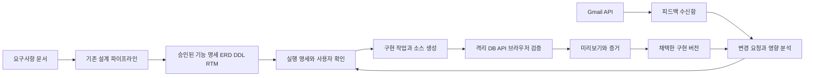

# Specton 후속 확장 개발 기획서

작성일은 2026-11-14이며, 현재 구현을 기반으로 개인 개발을 이어가기 위한 실행 계획이다. **요구사항 문서를 설계 산출물로 만드는 서비스에서, 승인된 명세로 업무 시스템을 구현·검증하고 고객 변경 요청까지 추적하는 서비스로 확장한다.**

2026-11-14부터 기획 순서에 따라 기반 구현을 시작했다. 현재 코드·검증 범위와 남은 작업은 [구현 진행 기록](08-implementation-progress.md)에 구분해 기록한다. 아래의 SDD 전체 생성·Gmail 피드백 기능은 아직 구현 완료 상태가 아니다. Gmail은 사용자 확인에 따라 **Gmail API 직접 연동**으로 확정한다.

## 읽는 순서

| 문서 | 결정할 내용 |
|---|---|
| [현재 프로젝트 분석](00-project-analysis.md) | 구현 구조, 네 산출물, 재사용 가능 영역, 실제 공백 |
| [품질과 최적화](01-quality-plan.md) | 근거가 있는 개선 목록, 우선순위, 성능 측정과 회귀 조건 |
| [SDD 구현 설계](02-sdd-plan.md) | 실행 명세, DB·API·화면 생성, 격리 실행, 테스트와 수정 루프 |
| [Gmail 피드백 설계](03-gmail-feedback-plan.md) | OAuth, 메일 동기화, 변경 요청, 영향 분석, 재구현·재검증 |
| [데이터와 API 계약](04-data-api-contracts.md) | 신규 데이터 모델, 버전·상태, API, 오류·멱등성 |
| [일정과 인수 기준](05-delivery-validation.md) | 개인 개발 일정, 작업 의존성, 기능별 완료 기준, 위험과 비용 |
| [전체 파일 지도](06-module-map.md) | 원본 추적 파일의 분류, Python 모듈별 책임, 화면·테스트 위치 |
| [분리와 검증 기록](07-repository-verification.md) | 변경 범위, 기존 근거 보존, 현재 실행한 검사와 미실행 항목 |
| [자동 검증 작업자](13-verification-worker-implementation.md) | 검증 요청·큐·취소·복구·플랫폼 증거 등록 |
| [승인 재고 정책 구현](12-inventory-ledger-implementation.md) | 입출고·취소·원장·동시성·실제 DB/HTTP 검증 |
| [생성 앱·격리 검증](11-generated-application-implementation.md) | 제한된 기준정보 소스 생성·실제 DB/HTTP 검증·남은 재고 범위 |
| [실행 명세 구현](10-specification-implementation.md) | 승인 설계 기반 초안·질문·계약 편집·버전·별도 승인 |
| [Google·프로젝트 구현](09-google-project-implementation.md) | 지속 로그인·소유권·실제 승인 기준 연결과 설정 |
| [구현 진행 기록](08-implementation-progress.md) | 현재 구현·검증 결과, 재현 명령, 다음 작업 |

## 제품 목표와 첫 적용 범위

첫 생성 대상은 재고 업무다. 창고·품목 등록, 입고 문서 작성·확정, 재고 조회, 출고 확정, 취소를 지원하는 작은 업무 시스템을 만든다. 독립된 실행 명세에서 권한·수량·상태·동시성·실패 조건을 확정하고 그 조건을 DB·API·UI·테스트에 동시에 연결한다.

초기 지원 기술은 기존 역량을 재사용하는 Python·FastAPI·Pydantic·psycopg·PostgreSQL과 React·TypeScript·Vite다. 플랫폼과 생성 앱은 별도 실행 단위·DB·자격 증명을 사용한다. 범용 다중 언어 생성, 임의 외부 제품 DB 직접 변경, 실제 운영 자동 배포는 첫 범위에 넣지 않는다. 설비 확장은 재고 수직 구현의 인수가 끝난 뒤 진행한다.

## 사용자 결과

1. 승인된 설계를 고르면 빠진 업무 규칙·화면·권한을 질문받고 실행 명세를 확정한다.
2. 생성된 초기 시스템을 미리보기에서 사용하며 요구사항별 테스트 결과와 코드 차이를 확인한다.
3. 고객 메일을 서비스에서 확인하고 요청 문장·원문 위치·영향 범위를 검토한다.
4. 변경을 승인하면 새 명세·코드·DB 이전안·미리보기가 생기며 기존 기능과 수정 기능의 테스트 결과를 함께 비교한다.
5. 검증된 후보를 채택해 새 기준 버전으로 고정한다. 메일 수신이나 LLM 판단만으로 기준 버전을 교체하지 않는다.

## 목표 구조

기존 설계 승인, 실행 명세 승인, 구현 후보 채택은 서로 다른 결정이다. 모든 결정은 대상 해시와 버전에 묶고, 검증한 소스와 채택한 소스가 달라지면 다시 검증한다.

## 구현 순서

기준선·인증·마이그레이션 기반 → 실행 명세·추적 계약 → 생성기·격리 실행 → 실제 API·브라우저 인수 → Gmail 수집·변경 분석 → 변경 후 전체 회귀 순서다. 예상 규모는 1인 전일 개발 기준 **68~96 작업일**, 통합 여유를 포함해 약 **16~23주**다. 외부 OAuth 심사 대기는 별도이며, 시간제 작업은 주당 투입 시간으로 환산한다. 근거와 단계별 중단 기준은 [일정과 인수 기준](05-delivery-validation.md)에 있다.

우선 착수 가능한 작업은 고정 합성 기준 입력과 CI 보완, 스키마 이전 기반, 실행 명세 계약이다. 실제 고객 메일 전송·외부 공개·운영 DB 변경은 그 구현 단계에서 검증된 후보와 대상 환경을 기준으로 처리한다.
